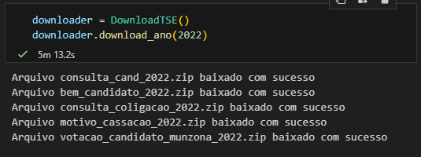
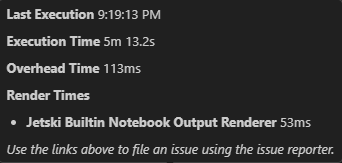
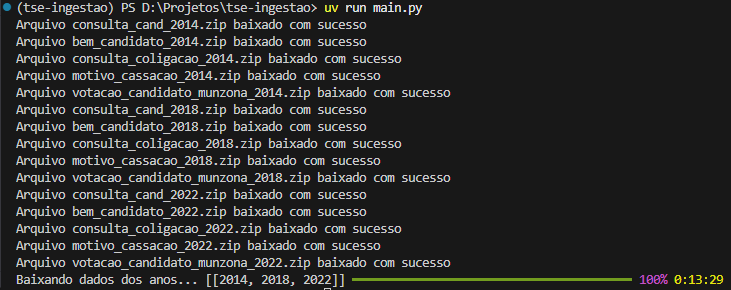
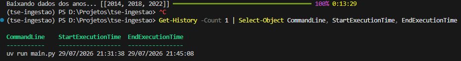

# TSE Ingestão 🗳️

O **TSE Ingestão** é um script utilitário em Python projetado para automatizar o download de dados públicos de estatísticas eleitorais diretamente dos servidores do Tribunal Superior Eleitoral (TSE) do Brasil. 

Este projeto serve como base para coleta de dados de candidaturas, bens de candidatos, coligações, motivos de cassação e votações por município e zona eleitoral.

> [!IMPORTANT]
> **Créditos e Atribuição:** O código original deste projeto foi desenvolvido por **Teo Calvo** no vídeo [TSE Analytics 2026 - Coletando Dados](https://www.youtube.com/watch?v=TNW990c3Vh4&t=2222s). Este repositório constitui uma implementação base para estudos e testes de otimização de performance.

[](https://www.youtube.com/watch?v=TNW990c3Vh4&t=2222s)

---

## 🛠️ O que ele faz e Como funciona

O script centraliza as operações na classe `DownloadTSE` contida no arquivo [main.py](file:///d:/Projetos/tse-ingestao/main.py). 

### Fluxo de Funcionamento:
1. **Inicialização:** Cria automaticamente um diretório local `./data` para armazenar os arquivos baixados, caso ele não exista.
2. **Download das Categorias:** Para cada ano especificado, o script faz requisições HTTP `GET` síncronas usando a biblioteca `requests` para os seguintes conjuntos de dados do TSE:
   - **Consulta Candidatura:** Informações cadastrais de candidatos (`consulta_cand_<ano>.zip`).
   - **Bens de Candidatos:** Relação de bens declarados pelos candidatos (`bem_candidato_<ano>.zip`).
   - **Coligações:** Detalhes de coligações partidárias (`consulta_coligacao_<ano>.zip`).
   - **Motivo de Cassação:** Dados de candidatos que tiveram registro cassado e seus motivos (`motivo_cassacao_<ano>.zip`).
   - **Votação por Município/Zona:** Resultados detalhados de votação (`votacao_candidato_munzona_<ano>.zip`).
3. **Organização Local:** Salva os arquivos zipados na estrutura de pastas `./data/<ano>/`.
4. **Monitoramento:** Utiliza o utilitário `track` da biblioteca `rich` para exibir uma barra de progresso interativa no terminal durante a iteração de múltiplos anos.

> [!NOTE]
> No estado atual, as requisições de download são executadas de forma sequencial (síncrona), o que pode limitar a performance dependendo da velocidade de conexão e do volume de dados.

---

## 🚀 Como Executar Localmente

Siga o passo a passo abaixo para configurar o ambiente e testar o script de ingestão.

### Pré-requisitos
* **Python** 3.10 ou superior.
* Gerenciador de pacotes **[uv](https://github.com/astral-sh/uv)** instalado globalmente (recomendado para performance e isolamento simples).

### 1. Clonar ou acessar o repositório
Abra o seu terminal no diretório do projeto:
```powershell
cd d:/Projetos/tse-ingestao
```

### 2. Configurar o Ambiente Virtual e Dependências
Você pode utilizar o ambiente virtual integrado `.venv`. Caso precise instalar as dependências requeridas (`requests` e `rich`):

**Usando o `uv`:**
```powershell
# Cria o ambiente virtual caso não exista
uv venv

# Ativa o ambiente virtual
# No Windows (PowerShell):
.venv\Scripts\Activate.ps1
# No Windows (CMD):
.venv\Scripts\activate.bat
# No Linux/macOS:
source .venv/bin/activate

# Instala as dependências necessárias
uv pip install requests rich
```

### 3. Executar o Script de Ingestão
Com as dependências instaladas e o ambiente virtual ativo, execute:
```powershell
uv run main.py
```
Isso iniciará o download dos dados para os anos de **2014**, **2018** e **2022** (conforme configurado por padrão em `main.py`). Os arquivos serão salvos progressivamente na pasta `./data/`.

---

## 📊 Evidências da Primeira Execução (Código Original)

Abaixo estão as evidências de execuções do código original desenvolvido por **Teo Calvo**, obtidas durante os testes iniciais do script em seu estado atual. Estes dados servirão como linha de base (baseline) para avaliar e comprovar a eficácia de futuras otimizações de performance (como concorrência, paralelismo ou assincronismo).


### 1. Execução da função `download_ano()`, apenas para o ano 2022:

  
*Execução da função download_ano(2022).*

  
*Detalhes do tempo de execução da função download_ano(2022).*

* **Tempo de Execução:** 5 minutos, 13 segundos e 2 décimos.  
* **Data de Execução:** 29/07/2026 21:19:13 (GMT -03:00)

### 2. Execução da função `download_anos()`, para os anos 2014, 2018 e 2022:

  
*Execução da função download_anos(2014, 2018, 2022).*

  
*Detalhes do tempo de execução da função download_anos(2014, 2018, 2022).*

* **Tempo de Execução:** 13 minutos, 29 segundos.  
* **Data de Execução:** 29/07/2026 21:31:38 (GMT -03:00)